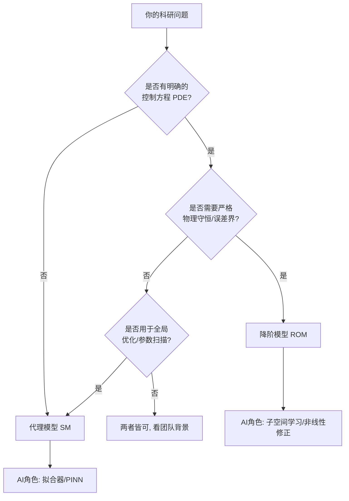

# 代理模型（SM）vs 降阶模型（ROM）：AI for Science 建模范式深度对比

> **来源**：飞书知识库 Wiki
> **原文链接**：https://jcn7kakdef35.feishu.cn/wiki/PNkowvvkmivZsIk6kzQcu1rKn8f
> **记录日期**：2026-08-25
> **主题**：AI for Science 建模选型方法论（SM vs ROM）

**标签**：#AIforScience #代理模型 #降阶模型 #ROM #PINN #物理信息神经网络 #多保真度

---

### 本文定位
> **本文是"补充笔记"，不是对某篇已有笔记的扩展**——08-23 笔记主题是"企业知识工程四道关"（业务治理视角），本文是"AI for Science 建模范式对比"（技术选型视角），两者同属 AI 工程化但维度不同。

**出处节范围**：

| 节 | 来源 | 说明 |
|----|------|------|
| 一~二 | **原文照录** | 核心差异对比 + 科研场景选择矩阵 |
| 三 | **原文照录** | 决策流程图（Mermaid 版） |
| 四 | **原文照录** | 前沿趋势：SM×ROM 融合 |
| 五 | **原文照录** | 最终建议 |
| 六~七 | **本笔记增补** | 领域映射（航空结构强度方向）+ 与既有笔记体系关联 |

---

## 一句话总纲

> **核心命题**：SM 与 ROM 不是非此即彼，而是两种不同的建模范式——选择的关键是 **"物理机理 vs 数据驱动"以及"可解释性 vs 泛化能力"** 的权衡。

---

## 一、核心差异对比

### 1.1 建模范式定位

| 维度 | 代理模型（Surrogate Model, SM） | 降阶模型（Reduced Order Model, ROM） |
|------|------|------|
| **本质** | 黑盒/灰盒拟合器：用数据替代昂贵仿真 | 基于 PDE 的低维投影：POD-Galerkin / RB 方法 |
| **物理机理依赖** | 弱——机理不明或过于复杂时可用 | 强——必须有明确的控制方程 |
| **可解释性** | 低（纯 SM）到 中（PINN） | 高——"尊重物理" |
| **误差界** | 无严格保证 | 有严格的误差上界 |
| **外推可靠性** | 低——训练域外易失控 | 高——适合极端工况 |
| **AI 融合空间** | 用 LLM 生成采样代码 / PINN 作为带约束 SM | 用 NN 学习低维子空间（替代 SVD）/ 学习非线性修正项 |

### 1.2 选择矩阵（原文照录）

#### ✅ 优先选【代理模型】的场景

| # | 场景 | 典型例子 |
|---|------|---------|
| 1 | 物理机理不明或过于复杂 | 湍流闭合、生物代谢网络、材料微观缺陷演化 |
| 2 | 优化设计 / 参数扫描 | 数百万个设计点中搜索最优解（Kriging、贝叶斯优化） |
| 3 | 多保真度融合 | 实验数据 + 低保真仿真 + 高保真仿真融合 |
| 4 | 快速原型验证 | 科研初期先验证"趋势对不对"，不需要严格物理守恒 |

> **AI 辅助切入点**：用 LLM 生成采样代码；用 PINN（物理信息神经网络）作为带物理约束的代理模型，弥补纯数据驱动的不足。

#### ✅ 优先选【降阶模型】的场景

| # | 场景 | 典型例子 |
|---|------|---------|
| 1 | 实时控制 / 数字孪生 | 飞行器姿态控制、芯片热管理——ROM 保证毫秒级响应下仍满足能量/质量守恒 |
| 2 | 参数化 PDE 求解 | 问题有明确 PDE 描述，参数变化范围已知 |
| 3 | 需要物理可解释性的论文 | 力学/流体/传热传统工科顶刊中，ROM 比纯黑盒 SM 更容易被审稿人接受 |
| 4 | 极端工况 / 安全关键系统 | 核反应堆、航空发动机等不允许"猜错"的领域 |

> **AI 辅助切入点**：用深度学习**学习 ROM 的低维子空间**（替代 SVD）；用 NN **学习 ROM 的修正项**（解决 Galerkin 投影的非线性瓶颈）——这就是当前最火的 **"AI-enhanced ROM"** 方向。

---

## 二、决策流程图

> **决策流程图**（HTML 决策树 + 逻辑表）

<table>
<thead><tr><th>判断节点</th><th>回答</th><th>→ 路线</th><th>AI 角色</th></tr></thead>
<tbody>
<tr><td>有明确控制方程 PDE？</td><td>否</td><td>→ <b>代理模型 SM</b></td><td>拟合器 / PINN</td></tr>
<tr><td rowspan="3">有明确 PDE？（是）</td><td>需要严格物理守恒/误差界？→ <b>是</b></td><td>→ <b>降阶模型 ROM</b></td><td>子空间学习 / 非线性修正</td></tr>
<tr><td>需要严格物理守恒/误差界？→ <b>否</b> → 用于全局优化？→ <b>是</b></td><td>→ <b>代理模型 SM</b></td><td>拟合器 / 贝叶斯优化</td></tr>
<tr><td>需要严格物理守恒/误差界？→ <b>否</b> → 用于全局优化？→ <b>否</b></td><td>→ 两者皆可，看团队背景</td><td>—</td></tr>
</tbody>
</table>

📊 决策流程图（Mermaid 源码，渲染需浏览器支持）

**决策逻辑树**：

| 判断节点 | 回答 | 路线 |
|---------|------|------|
| 有明确 PDE? | 否 | → SM |
| 有明确 PDE? | 是 → 需要严格物理守恒? | 是 → ROM / 否 → 下一步 |
| 需要严格物理守恒? | 否 → 用于全局优化? | 是 → SM / 否 → 看团队背景 |
| SM 路线中 AI 角色 | — | 拟合器 / PINN |
| ROM 路线中 AI 角色 | — | 子空间学习 / 非线性修正 |

---

## 三、前沿趋势：SM × ROM 融合

### 3.1 界限正在模糊

> **在当前 AI for Science 研究前沿，SM 与 ROM 的界限正在模糊。**

| 方向 | 描述 | 发表潜力 |
|------|------|---------|
| 纯 SM | 容易被质疑"缺乏物理" | 中 |
| 纯 ROM | 容易被质疑"不够新颖" | 中 |
| **融合路线** | "AI 增强的物理降阶模型" / "物理约束的神经算子" | **高** |

> **关键洞察**：如果目标是发高水平论文，建议走**融合路线**。当前最容易出成果的交叉点是 **"AI 增强的物理降阶模型"** 或 **"物理约束的神经算子"**。

### 3.2 三种融合模式

| 模式 | 核心思路 | 代表技术 |
|------|---------|---------|
| **PINN（物理信息神经网络）** | 将 PDE 残差作为 loss 惩罚，让神经网络在训练过程中尊重物理守恒 | Raissi et al. PINN |
| **AI-enhanced ROM** | ROM 提供物理子空间结构，NN 学习子空间中的非线性修正项 | DeepONet、Fourier Neural Operator (FNO) |
| **多保真度融合 SM** | 低保真 ROM + 高保真实验数据，用 SM 作为桥梁做保真度跨越 | CoKriging、多保真度 GP |

---

## 四、最终建议（原文）

> 如果你能告诉我具体的**研究领域**（如流体力学、材料科学、生物医学等）和**研究阶段**，我可以给出更精准的模型选型和 AI 工具链推荐。

---

## 五、领域映射：航空结构强度方向（本笔记增补）

> 本文的建模范式选择框架可直接映射到本机已有航空垂域研究笔记（08-25《航空垂域模型结构强度方向综合研判》第六章）。

### 5.1 航空结构方向的具体应用对照

| 建模范式 | 航空结构强度方向的具体应用 | 08-25 垂域报告章节 |
|---------|----------------------|----------------|
| **代理模型 SM** | 参数化结构优化（数百万工况扫描最优布局）、多保真度 FEM 融合、早期设计阶段趋势验证 | 第四章（代理模型路线）、第五章（风险清单） |
| **降阶模型 ROM** | 实时结构健康监测（SHM）中的毫秒级响应、适航验证中的误差界证明、极端工况（飞鸟撞击、疲劳极限）预测 | 第四章（ROM 路线）、适航 CCAR-25 对应节 |
| **融合路线** | "AI 增强的数字孪生"——ROM 提供物理骨架 + NN 修正项，用于结构寿命预测（RUL） | 第六章 方法层深化 |

### 5.2 选择框架在航空方向的落地

> **航空方向落地流程图**（HTML 决策树）

<table>
<thead><tr><th>判断层级</th><th>判断条件</th><th>→ 选型</th></tr></thead>
<tbody>
<tr><td rowspan="2">第1层</td><td>是否有明确的 PDE？ (结构力学 PDE 通常有) → <b>是</b></td><td>进入第2层</td></tr>
<tr><td rowspan="4">第2层 是否需要严格物理守恒/误差界？</td><td>→ <b>是</b>（适航验证/安全关键）</td></tr>
<tr><td colspan="2">→ <b>降阶模型 ROM</b>（POD-Galerkin + RB 方法）</td></tr>
<tr><td>→ <b>否</b>（早期设计/参数优化）</td></tr>
<tr><td rowspan="2">第3层 是否用于全局优化？</td><td>→ <b>是</b> → <b>SM</b>（Kriging 全局优化）</td></tr>
<tr><td>→ <b>否</b> → 两者皆可，看团队背景</td></tr>
</tbody>
</table>

### 5.3 三种范式在航空方向的代表性工作

| 范式 | 文献方向 | 发表阵地 |
|------|---------|---------|
| SM（Kriging/BayOpt） | 结构拓扑优化、多目标参数扫描 | Aerospace, Structural and Multidisciplinary Optimization |
| ROM（POD-Galerkin） | 气动弹性、非线性动力学降阶 | Journal of Fluids and Structures, AIAA Journal |
| 融合（PINN / FNO） | 多保真度结构分析、数字孪生 SHM | Computer Methods in Applied Mechanics and Engineering (CMAME), AIAA SciTech |

---

## 六、与既有笔记体系关联

| 笔记 | 关联方式 |
|------|---------|
| [08-25 航空垂域模型结构强度方向综合研判](./2026-08-25-航空垂域模型结构强度方向综合研判技术报告.md) | 本文决策框架直接映射到该报告第六章的方法层深化 |
| [08-02 航空结构设计AI2026前沿](./2026-08-02-航空结构设计AI2026前沿-多模态知识图谱与生成式设计.md) | 生成式设计本质是 SM 在结构设计空间的全局优化 |
| [08-03 Agent记忆系统2026](./2026-08-03-Agent记忆系统2026-基准Benchmark与四维架构.md) | — 主题无关，不关联 |
| [08-23 AI企业知识工程四道关](./2026-08-23-AI企业知识工程四道关-土猛的员外AI落地隐性共识.md) | 知识工程治理视角 vs 本文技术建模视角——两个维度，不重叠 |

---

## 七、金句摘录

> "SM 和 ROM 并非非此即彼，而是代表了两种不同的建模范式。"

> "在力学、流体、传热等传统工科顶刊中，ROM 比纯黑盒 SM 更容易被审稿人接受，因为它'尊重物理'。"

> "如果用 LLM 生成采样代码；用 PINN 作为带物理约束的代理模型，弥补纯数据驱动的不足。"

> "如果你的目标是发高水平论文，建议走融合路线。纯 SM 容易被质疑'缺乏物理'，纯 ROM 容易被质疑'不够新颖'。"

> "AI-enhanced ROM：用深度学习学习 ROM 的低维子空间（替代 SVD）；用 NN 学习 ROM 的修正项（解决 Galerkin 投影的非线性瓶颈）。"

---

## 相关笔记

- [08-25 航空垂域模型结构强度方向综合研判技术报告](./2026-08-25-航空垂域模型结构强度方向综合研判技术报告.md) — 决策框架直接映射
- [08-02 航空结构设计AI2026前沿](./2026-08-02-航空结构设计AI2026前沿-多模态知识图谱与生成式设计.md) — 生成式设计 = SM 全局优化
- [08-23 AI企业知识工程四道关](./2026-08-23-AI企业知识工程四道关-土猛的员外AI落地隐性共识.md) — 企业 AI 治理视角（同主题不同维度）
